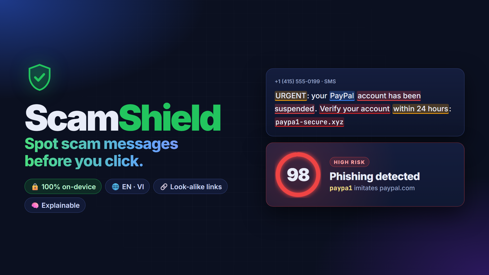
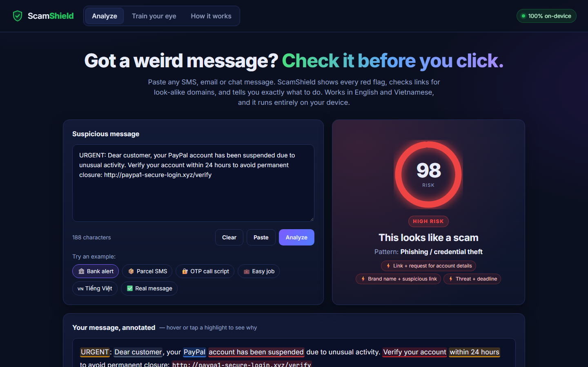
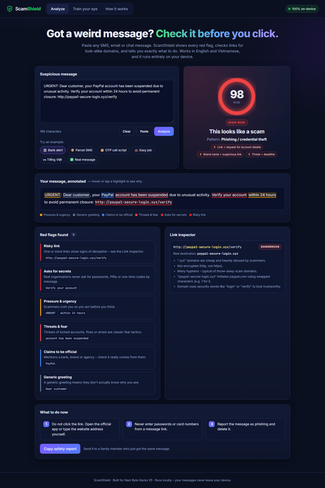
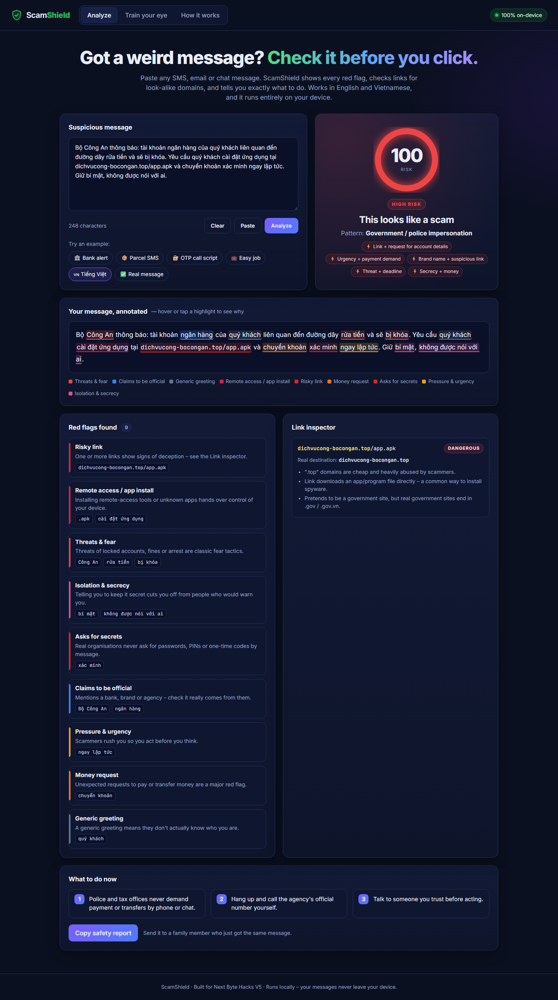
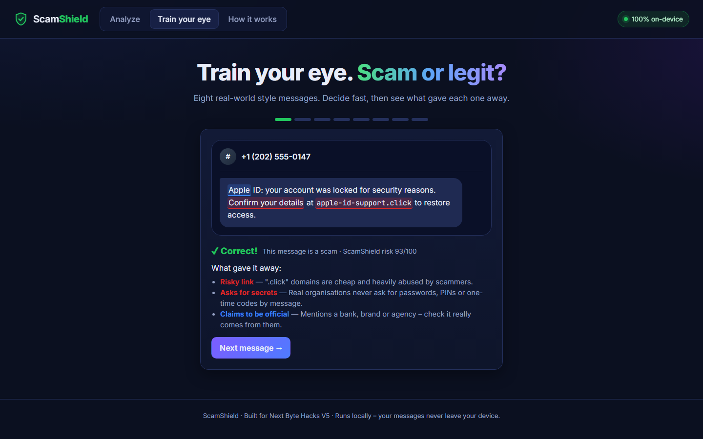
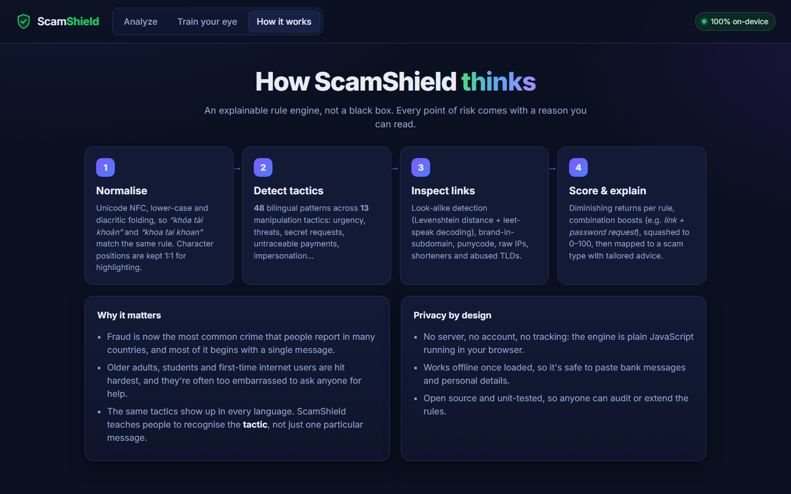
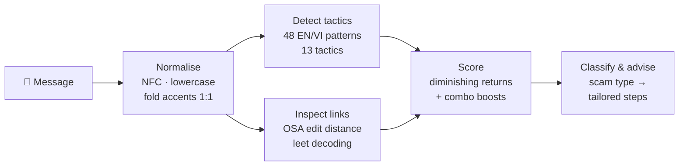

<div align="center">



# 🛡️ ScamShield

**Spot scam messages before you click.**

Paste any suspicious SMS, email or chat message to get an explained risk score, highlighted red flags and look-alike link detection. It works in English and Vietnamese and runs entirely in your browser.

[](https://aivietnam-aio-felixdoit.github.io/scamshield/)
[](https://youtu.be/-GJfiwtbLxE)


[](LICENSE)


</div>

---

## 📖 Table of contents

- [Why ScamShield](#-why-scamshield)
- [Screenshots](#-screenshots)
- [Features](#-features)
- [How it works](#-how-it-works)
- [Getting started](#-getting-started)
- [Project structure](#-project-structure)
- [Roadmap](#-roadmap)
- [License](#-license)

## 💡 Why ScamShield

Scam messages work because they push our emotions with **fear, urgency, greed or secrecy**. The people hit hardest are parents, grandparents, students and new internet users, and most of them were never taught the warning signs.

Existing tools either say nothing ("message filtered") or need you to upload private messages to a server. ScamShield **explains** its verdict, so each check also teaches the user something, and it keeps every message **on the device**.

## 📸 Screenshots

<table>
  <tr>
    <td colspan="2" align="center"><b>Instant risk score with every red flag explained</b><br></td>
  </tr>
  <tr>
    <td width="50%" align="center"><b>Annotated message, red flags and link inspector</b><br></td>
    <td width="50%" align="center"><b>Vietnamese scam (fake police and .apk link)</b><br></td>
  </tr>
  <tr>
    <td width="50%" align="center"><b>Train your eye quiz</b><br></td>
    <td width="50%" align="center"><b>How it works</b><br></td>
  </tr>
</table>

## ✨ Features

| | Feature | What it does |
|:-:|---|---|
| 🎯 | **Instant risk score** | Animated 0–100 gauge, a verdict (low, suspicious or high) and the detected scam type: phishing, OTP theft, fake delivery, task scam, police impersonation and more |
| 🖍️ | **Annotated message** | Every red flag is highlighted inside the original text. Hover or tap one to see the tactic in plain language |
| 🔗 | **Link inspector** | Finds look-alike domains (`paypa1`, `amaz0n`, `netfilx`), brand names hidden in sub-domains, punycode, raw IP addresses, URL shorteners, abused TLDs, `@` tricks, `.apk` downloads and fake government sites |
| ⚡ | **Combination boosts** | Dangerous pairs such as *link + password request* or *secrecy + money* raise the score |
| 🧭 | **What to do now** | Advice tailored to the scam type, plus a **Copy safety report** button you can use to warn family members |
| 🌐 | **Bilingual** | English and Vietnamese patterns. Diacritic folding matches text written with or without accents |
| 🎓 | **Train your eye** | Quiz mode: decide whether a message is a scam or legit, then see what gave it away |
| 🔒 | **Private by design** | No backend, account, tracking or AI API. Works offline once loaded |

## ⚙️ How it works



- **Normalisation** folds diacritics one character at a time, so positions in the folded text map 1:1 back to the original. That's what makes in-place highlighting possible.
- **Scoring:** each rule counts at most three times, with decreasing weight (1, 0.6, 0.3). Combination boosts are added on top, and the total is squashed with `100·(1−e^(−x/45))` into a stable 0–100 score.
- **Look-alike detection:** after decoding character swaps (`0→o`, `1→l`, `rn→m`, …) and computing optimal-string-alignment distance against a list of official brand domains, the inspector flags any domain that is one edit away, or that uses a brand name without being the brand's real domain.
- **No false alarms on safety notices:** "we will never ask for your password" cancels out the secret-request rule that would otherwise fire on it.

All of the logic lives in [`src/engine.js`](src/engine.js), a dependency-free module that runs in both the browser and Node.

## 🚀 Getting started

The easiest way is to open the **[live demo](https://aivietnam-aio-felixdoit.github.io/scamshield/)**.

To run it locally (no build step needed):

```bash
git clone https://github.com/AIVIETNAM-AIO-felixdoit/scamshield.git
cd scamshield

# Option 1: open the file directly
start index.html        # Windows  ·  macOS: open index.html  ·  Linux: xdg-open index.html

# Option 2: serve it
npm start               # → http://localhost:8080
```

Run the unit tests (Node 18 or later):

```bash
npm test
```

## 🗂️ Project structure

```
scamshield/
├── index.html            # app shell (Analyze / Train your eye / How it works)
├── src/
│   ├── engine.js         # detection engine: rules, URL analysis, scoring, classification
│   ├── samples.js        # example messages and quiz data
│   ├── app.js            # UI rendering, tooltips, quiz logic
│   └── styles.css        # styles
├── test/
│   └── engine.test.js    # unit tests (node:test)
├── tools/                # automated demo-video pipeline (Playwright + TTS + ffmpeg)
└── screenshots/          # images for the README and submission
```

## 🛣️ Roadmap

- [ ] Browser extension that checks Gmail and Outlook messages in place
- [ ] Android share target, so you can share a suspicious SMS straight to ScamShield
- [ ] More languages (Spanish, Hindi, Indonesian, Tagalog)
- [ ] A community-reported domain blocklist, while keeping the core engine offline

## 📄 License

Distributed under the **MIT License**. See [`LICENSE`](LICENSE) for details.

<div align="center">
<sub>Built for <b>Next Byte Hacks V5</b> · November 2026 · Stay safe out there 🛡️</sub>
</div>
